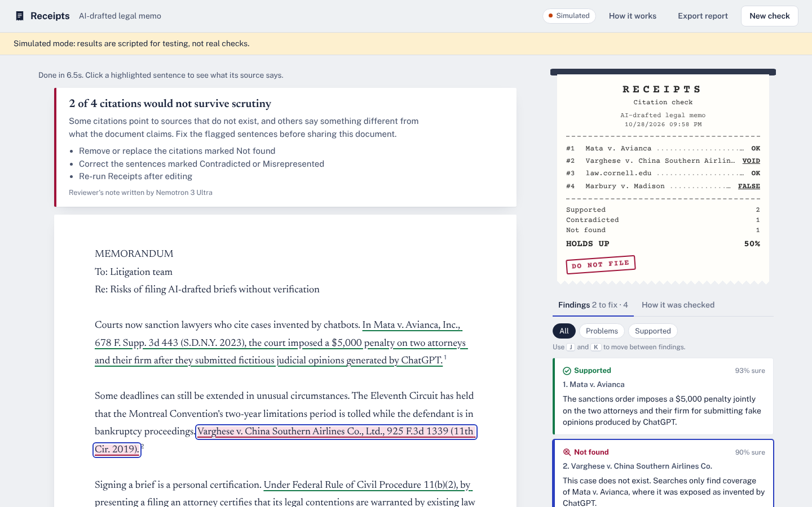

# Receipts

**Paste a document. See whether its sources actually say what it claims they say.**

Receipts reads every sentence that cites a source (a link, a court case, a statute, a paper, a reference-list entry), finds and reads that source, and marks the sentence in place, the way a spell-checker marks a typo:

| Verdict | Meaning |
|---|---|
| Supported | The source says what the document says. |
| Partly supported | The document overstates it or drops a qualifier. |
| Misrepresented | Right source, wrong details: a number, a holding, an altered quote. |
| Contradicted | The source says the opposite. |
| Not found | No copy of the source exists online. Possibly invented. |
| Can't verify | The source exists but couldn't be read (paywall, print-only). |

Click any highlighted sentence to see the exact passage from the source, a rewrite the source does support, and which model made the call.

- **Live demo:** `<add your Hugging Face Space URL>`
- **Demo video (under 3 minutes):** `<add your YouTube URL>`
- **Built for:** the Nebius x NVIDIA Global AI Hackathon, Best Apps and Agents track



---

## Why this exists

AI writing tools produce fluent text with confident footnotes, and the footnotes are where they fail quietly.

- US courts imposed at least **$145,000 in sanctions** for AI-fabricated citations in the first quarter of 2026 alone, including a six-figure penalty in the Sixth Circuit. ([JD Supra](https://www.jdsupra.com/legalnews/the-ai-sanction-wave-145k-in-q1-1240943/), [Mondaq](https://webiis10.mondaq.com/unitedstates/new-technology/1764522/6th-circuit-court-of-appeals-issues-six-figure-sanctions-for-three-ai-hallucinated-appeals))
- A federal court excluded an expert's report because it cited academic articles that don't exist. ([WSBA](https://nwsidebar.wsba.org/2026/08/31/federal-court-excludes-expert-for-ai-hallucinated-citations/))
- GPTZero found hallucinated citations in **50 ICLR 2026 submissions** that 3–5 peer reviewers each had missed, and at least 100 in NeurIPS 2025 accepted papers. ([GPTZero](https://gptzero.me/news/emnlp-partners-with-gptzero/), [GPTZero](https://gptzero.me/news/neurips/))

**Who it's for:** lawyers and paralegals before filing; editors, fact-checkers and journalists before publishing; peer reviewers and teachers reading submissions; students checking their own AI-assisted drafts.

**What's different from existing tools.** Reference checkers such as GPTZero's Hallucination Check and scite's Reference Check focus on the bibliography: does the reference exist, was it retracted. Receipts checks the harder failure: **a real source cited for something it doesn't say** (the wrong number, the reversed holding, the altered quote), and it works on any kind of citation, from case law to a blog link, with no account.

---

## How it works

```
document ─► Nemotron 3 Nano ─► cited claims (exact sentence, citation, quote, search query)
                                   │
                ┌──────────────────┴───────────────────┐
           has a link                             case / paper / book
                │                                       │
      Tavily Extract, reranked                Tavily Search  ─► Nemotron 3 Nano picks
      to the claim being checked                               the result that IS the source
                └──────────────────┬───────────────────┘
                                   ▼
                    Nemotron 3 Super judges claim vs. passages
                    and must copy the sentences it relied on
                                   │
                    grounding check: is that quote really in the source?
                                   │
        risky verdict, low confidence or ungrounded quote ─► Nemotron 3 Ultra second opinion
                                   │
                    Nemotron 3 Ultra writes the reviewer's note
```

Every step streams to the browser, so you watch the document light up claim by claim. The **How it was checked** tab lists every model and Tavily call with timings and tokens.

### Which model does what

| Role | Model on Nebius Token Factory | Job | Why this model |
|---|---|---|---|
| Fast | NVIDIA Nemotron 3 Nano 30B-A3B | Extract cited claims; match search results to a citation | Many short structured calls; cheap and quick, run with thinking off |
| Judge | NVIDIA Nemotron 3 Super 120B-A12B | Compare each claim with its source passages | Careful reading with reasoning, at a price that allows one call per claim |
| Reason | NVIDIA Nemotron 3 Ultra 550B-A55B | Second opinion on risky or uncertain verdicts; decide whether an unfindable source exists; write the summary | The decisions where a mistake hurts someone, so the strongest model only sees those |

This follows the track's own advice: Ultra for serious reasoning, Nano and Super for the everyday calls. By design Ultra only sees flagged, uncertain or ungrounded claims, and the trace panel reports how many that was for each run.

### Where Nebius Token Factory accelerated the work

- **One OpenAI-compatible endpoint for three Nemotron sizes.** Switching a role from one model to another is a one-line environment change, which is how the Nano/Super/Ultra split was tuned.
- **JSON mode** keeps the structured replies parseable; Receipts detects any model that rejects it and falls back to plain JSON prompting automatically.
- **Model listing** (`GET /v1/models`) lets Receipts resolve each configured model ID against the account, which protects against the differences in ID casing between documentation pages.

### How Tavily is used

- **Extract with `query` + `chunks_per_source`**: for a cited link, Tavily returns only the passages most relevant to the claim being checked. This keeps the judge's context small and on-topic, which keeps each check fast and cheap.
- **Search (advanced depth)**: for cases, papers and books without a link, two query formulations are tried before anything is called "Not found".
- **Find a source that supports this**: a button on flagged claims searches the open web for a source that genuinely backs the sentence, and Nemotron 3 Super picks the best one.
- **Check a URL**: paste a link instead of text and Tavily Extract reads the article.

### Safeguards against the checker itself hallucinating

1. **Evidence must be copied, then verified.** The judge has to quote the source sentences behind its verdict; Receipts then checks those sentences really appear in the source text (exact match, then a fuzzy match tolerant of whitespace and quote styles). Unverified quotes lower confidence and trigger an Ultra review, and the card says so.
2. **The document's own quotations are checked word-for-word** against the source before the judge sees them.
3. **Two-model agreement on anything damaging.** "Not found", "Contradicted" and "Misrepresented" always get an Ultra second opinion, and Ultra is told that a false accusation of fabrication is as costly as a missed one. When Ultra overturns Super, the card shows it.
4. **"Can't verify" is a first-class verdict**, so a paywall never turns into a false "Not found".

---

## Run it locally

Requires Python 3.11+.

```bash
git clone https://github.com/<your-github-username>/receipts.git
cd receipts
python -m venv .venv && source .venv/bin/activate      # Windows: .venv\Scripts\activate
pip install -r requirements.txt
cp .env.example .env                                   # then paste your two keys into .env
python scripts/doctor.py                               # checks keys, model IDs, Tavily
uvicorn app.main:app --port 8000
```

Open http://localhost:8000 and click a sample, paste text, paste a link, or drop a PDF/DOCX.

- **Keys:** Nebius Token Factory key from https://tokenfactory.nebius.com and a Tavily key from https://app.tavily.com (the free tier is enough).
- **`scripts/doctor.py`** lists the Nemotron models on your account and sends one request to each, so a wrong model ID or base URL shows up in seconds rather than mid-demo.
- **`scripts/record_samples.py`** runs the three samples live and saves the runs to `data/cache/`. A deployed demo replays those recorded runs instantly (labelled "Replay of a live run"), so the samples keep working even if API credits run out. Pasted text always runs live.
- **No keys yet?** `RECEIPTS_MOCK=1 uvicorn app.main:app` runs a simulated mode for UI work. It is labelled "Simulated" on screen and its runs are never saved as replays.

Deployment to Render (free web service): see [docs/DEPLOY_RENDER.md](docs/DEPLOY_RENDER.md). Hugging Face Docker Spaces and Nebius Serverless Endpoints: see [docs/DEPLOY.md](docs/DEPLOY.md); Hugging Face Docker Space creation currently requires a paid subscription.

## Tests

```bash
pip install -r requirements-dev.txt
pytest -q
```

The suite runs the real Token Factory and Tavily clients against simulated HTTP servers, covering request shapes, auth headers, model-ID resolution, the JSON-mode fallback, reasoning-text stripping, escalation rules and the full pipeline, plus the streaming API and replay cache.

## Accessibility

- Verdicts are always shown with an icon and a word, never by color alone; problem highlights also differ in underline style.
- Full keyboard use: Tab to any highlighted sentence, Enter to open it, **J/K** to move between findings, Esc to close.
- Progress and each verdict are announced to screen readers through a live region.
- Honors `prefers-reduced-motion` and `prefers-color-scheme`; works down to phone width.

## Limitations and known failure cases

Receipts gives evidence, not a ruling. Open the source before acting on a flag.

- **Paywalled and print-only sources** usually come back as "Can't verify". Receipts reads only what Tavily can reach on the open web.
- **Case law on subscription databases**: a real but obscure unpublished opinion may only exist on Westlaw or Lexis, which can produce a "Not found". Ultra is instructed to prefer "Can't verify" when the evidence is thin, but this is the most important false-positive risk.
- **Badly formatted citations** (wrong year, misspelled author) can look like fabrications; the explanation says what was searched.
- **Pinpoint citations** (a specific page) are checked against the passages Tavily returns, not the exact page.
- **Very long documents** are capped at 40,000 characters and 30 claims per run (configurable).
- **Model judgment varies**: two runs on the same document can differ on borderline "Partly supported" cases.
- Only English has been tested.

## Project structure

```
app/
  main.py        HTTP API, streaming, replay cache, rate limits
  pipeline.py    the agent: extract -> find source -> judge -> verify -> escalate -> report
  llm.py         Nebius Token Factory client (model resolution, JSON fallback, retries)
  tavily.py      Tavily Search + Extract client
  prompts.py     prompts for the three Nemotron roles
  grounding.py   passage ranking and quote verification
  documents.py   PDF/DOCX/TXT parsing, sentence splitting, claim location
  samples.py     the three demo documents
  mock.py        simulated mode (RECEIPTS_MOCK=1) for development only
static/          the single-page app (no build step)
scripts/         doctor.py, record_samples.py
tests/           pytest suite
```

## License

[MIT](LICENSE). Bundled fonts (Newsreader, Public Sans, Courier Prime) are under the SIL Open Font License; see `static/fonts/FONTS-LICENSE.md`.
